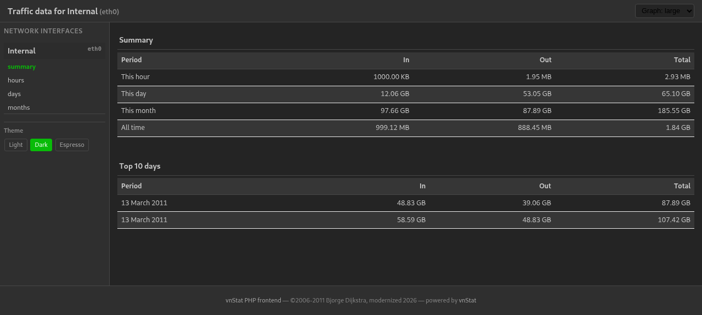
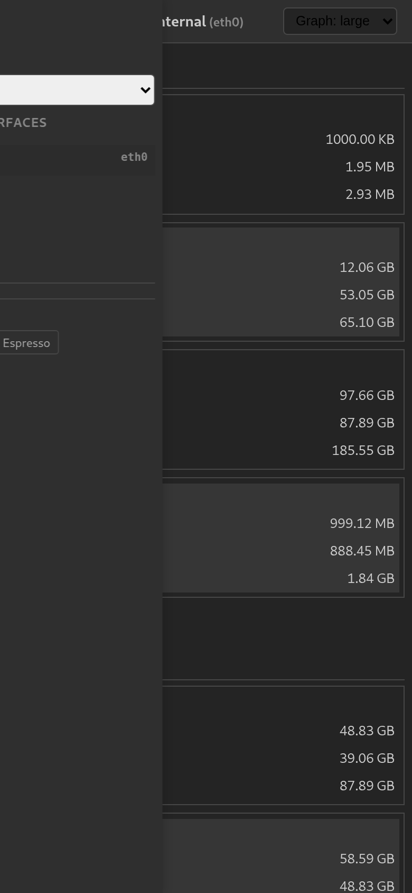
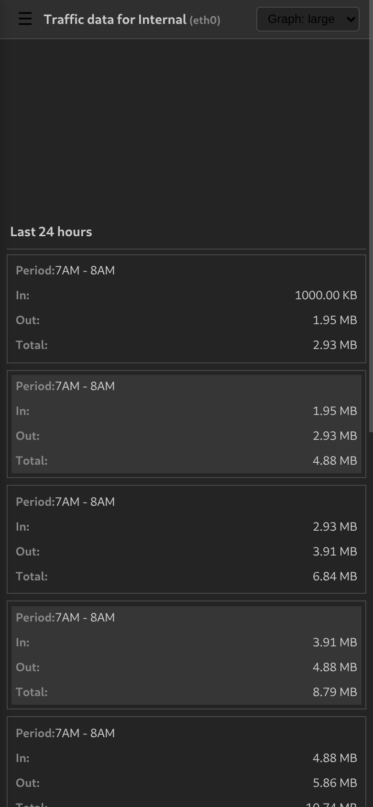

# vnStat PHP Frontend

A modernized, mobile-friendly PHP frontend for [vnStat](https://humdi.net/vnstat/) — a console-based network traffic logger.


---

## What is It?

This is a PHP frontend for vnStat, a network traffic logger. Since vnStat is console-mode only this script provides a nice web-based report of the traffic data collected by vnStat.

## Features

- **Responsive mobile-first design** — works on phones, tablets, and desktops with a sidebar that collapses into an off-canvas menu on small screens.
- **Three built-in themes** — Light, Dark, Espresso. Switch theme per session via the sidebar switcher.
- **SVG traffic graphs** — crisp 3-D bar charts rendered inline as SVG, automatically scaling to fit the container width.
- **Hourly, daily, monthly, and summary views** with sortable data tables that adapt to narrow screens (card-style layout on mobile).
- **Live JSON data endpoint** — `json.php` returns parsed vnStat data as JSON for client-side dashboards.
- **PHP 8.x+** — fully compatible with modern PHP (tested on PHP 8.5.12). Deprecated functions (`strftime`, `define`) replaced.
- **Docker support** — official `php:latest` image for isolated testing.
- **i18n** — 16 language files included (en, de, fr, nl, ru, …). Add more by creating a new language file.

## Requirements

- vnStat installed and collecting data
- Web server with PHP (8.x+)
- For PNG graphs: php-gd extension (optional; SVG is the default)

## Quick Start

1. **Clone** this repository into your webroot or a Docker container.

2. **Edit** `config.php`:
   - Add your network interface(s) to `$_iface_list`
   - Optionally name them in `$_iface_title`
   - Set `$_vnstat_bin` to the path of your vnStat binary (or use file dumps — see `config.php` for details)

3. **Serve**:

   With PHP's built-in development server:
   ```bash
   php -S 0.0.0.0:8080 -t /path/to/project
   ```

   With Docker:
   ```bash
   docker build -t vnstat-frontend .
   docker run -p 8080:8080 vnstat-frontend
   ```

   Then open `http://localhost:8080/` in your browser.

## Docker for Testing

A `Dockerfile` is provided for easy testing. It uses the official `php:latest` image and PHP's built-in development server.

```bash
docker build -t vnstat-frontend .
docker run -d --name vnstat-test -p 8080:8080 vnstat-frontend
```

A sample data file (`dumps/vnstat_dump_eth0`) is included so the interface renders without a real vnStat installation.

## Data Sources

Two sources are supported (configured in `config.php`):

1. **vnStat binary** — calls `vnstat --dumpdb -i <iface>` on each request (set `$_vnstat_bin`)
2. **File dumps** — pre-dumped vnStat database files generated by cron (clear `$_vnstat_bin` and set `$_data_dir`)

Generate dumps:
```bash
vnstat --dumpdb -i eth0 > /path/to/data_dir/vnstat_dump_eth0
```

## Screenshots

| Desktop (Summary) |
|:---:|
|  |

| Mobile (Summary) | Mobile (Hours) |
|:---:|:---:|
|  |  |

## License

Copyright © 2006–2011 Bjorge Dijkstra (bjd@jooz.net)  
CasjaysDev © 2026

This program is free software; you can redistribute it and/or modify it under the terms of the GNU General Public License version 2, as published by the Free Software Foundation.

See [COPYING.md](COPYING.md) for the full license text.
